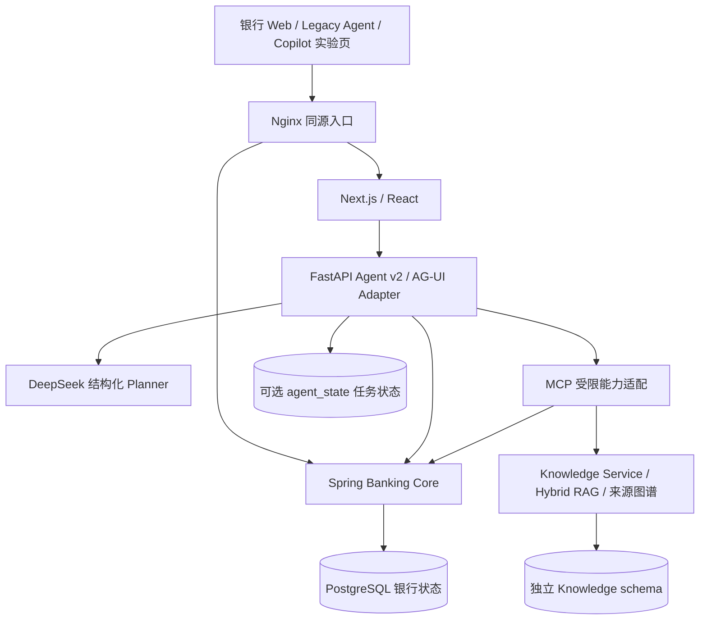

# 系统架构

当前源码基线：2026-10-20。部署版本与验收证据需另外核对 [综合验收](../milestones/aster-integrated-final-acceptance.md) 和 [KG/RAG 验收](../milestones/kg-rag-completion.md)。本页替代早期 M0–M24 累积说明，历史设计仍见 ADR 与各里程碑。

## 请求与执行

普通银行页面使用生成的 Customer/Public 客户端；Docker 部署由代理转发 `/customer/*` 和 `/public/*`。Agent 浏览器请求通过 Next 同源服务端路由抵达 FastAPI，模型密钥只在服务端。实验页与 Legacy 页面继续共存。

Agent v2 将用户目标、允许工具 schema 和历史 observation 交给模型；Registry 校验模型的结构化工具决策。每次读取结果进入下一次模型调用。PREPARE 返回有效银行 ActionIntent 后立即停止规划并进入 WAITING_CONFIRMATION。确认、step-up、执行重验、归属和幂等由可信路径与 Banking Core 决定；LLM 没有直接执行、任意 REST/URL、SQL 或管理员工具。

## 数据权威

- Banking Core 是余额、交易、卡片、持仓、银行授权、ActionIntent 和金融回执的唯一权威；Agent 不直连银行业务表。
- Agent 可选持久任务存储保存线程、任务、Ledger、去重、租约与版本。未启用时仍为进程内存，不宣称跨进程恢复全部通过。
- Knowledge Service 存储已审核的公开 Aster Demo Policy、版本、分块、向量和来源关系；不存客户流水。RAG/KG 仅提供解释证据，不能决定金融执行权限。
- 商户、备注、昵称、工具内容和检索文本均为低信任数据；导航地址由可信 Route Registry 生成。
- 金额以 decimal string/精确数值传递；图表是银行工具结果的展示，不能替代权威统计。Overview 是派生 read model，不维护第二份账户余额。

## 合同、测试与部署

Customer 87、Public 9 个 operation 的唯一机器契约位于 `contracts/openapi`；结构冻结和历史版本由合同审计检查。Spring Flyway 历史保留至 V34，知识图谱使用独立 KG001 迁移。Agent state 有独立迁移路径。

MSW 仅用于测试或显式 mock 模式，真实后端失败不自动选择 fixture。测试数据库、容器和浏览器上下文必须与保留的开发数据隔离。统一 [启动入口](../../START-README.md) 管理 Compose 项目，不从历史报告复制旧端口或进程号。

S1/R1 与综合验收仍为 PARTIAL。金融逐项执行不提供跨领域原子回滚；Task Ledger 完成性、恢复和攻击测试的剩余问题继续按原报告披露。

## 详细说明

- [Agent Runtime](../../services/agent-runtime/README.md) / [Banking Core](../../services/banking-core/README.md)
- [Web 集成](../frontend/backend-integration.md) / [API 工作流](../api/README.md)
- [Durable Runtime](durable-agent-runtime.md) / [Task Ledger](task-ledger-and-verification.md)
- [AG-UI](ag-ui-adapter.md) / [CopilotKit](copilotkit-integration.md)
- [知识库](banking-knowledge-base.md) / [Hybrid RAG](hybrid-rag.md) / [知识图谱](banking-knowledge-graph.md)
- [ADR](../adr) / [验收索引](../README.md)
