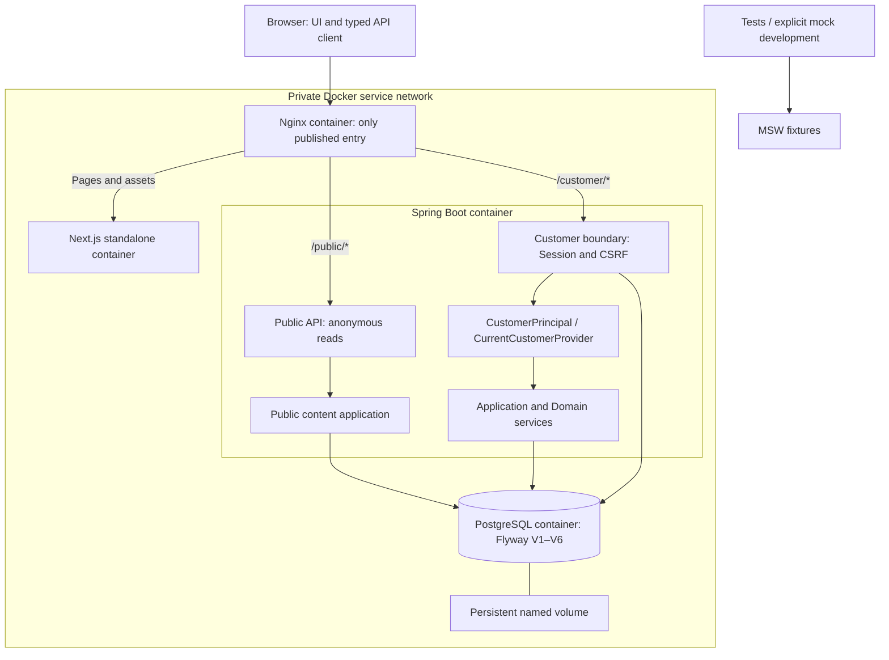

# Aster Bank Web system

M24 packages Aster Bank Web V1 with the frozen Customer 1.9.0 and Public 1.2.0 interfaces. It provides a self-contained demo deployment and production-oriented deployment foundation. No live money is processed.

Next.js serves pages and assets; it does not proxy banking requests. Browser Customer requests include cookies; Public requests omit them. Generated types, not duplicate DTOs, describe all 48 operations. The backend remains a modular monolith.

## Authority and boundaries

- PostgreSQL owns balances, transactions, intents, receipts, idempotency, card state, recurring state, holdings, security state and public content.
- Overview is a read model in a read-only REPEATABLE READ transaction. It does not own copies of financial state.
- Financial mutations and their receipts, ledger entries, idempotency records and authorization consumption commit or roll back together.
- Application/Domain use ports and an injected Clock. HTTP, JPA, generated contracts and Spring Security stay in adapters; ArchUnit enforces those boundaries.
- Step-up produces a short-lived single-use authorization bound to customer, session, resource type, resource ID and hash. The session stays AAL1.
- MSW is enabled only by explicit mock mode or tests. Failure of Spring never selects fixtures.
- No Agent implementation exists. Future Agents must use Banking APIs and never access the database directly.

## Recovery

The client bounds requests to 20 seconds, including body reads. Query cancellation aborts transport. Mutations have no automatic retry; the review retains its intent and idempotency key after an uncertain outcome. A definite 409 invalidates affected authoritative queries and requires a fresh review. Session invalidation removes Customer queries and mutation variables while preserving Public content.

The real-system test runner owns a uniquely named Docker Compose project, disposable PostgreSQL volume, Spring process and Next process. Files in its private test-results directory control process interruption; there are no test HTTP endpoints. Service restarts retain the test database. Cleanup removes only that project's resources, never the developer's retained database.

## M24 容器部署

部署增加 Nginx → Web standalone / Banking Core → PostgreSQL named volume。同源 /customer/_、/public/_ 保留原路径；只有代理发布主机端口，后端 Actuator 内部使用。Web 镜像使用显式 / API origin，不绑定部署域名。详见 [部署](../deployment/demo-deployment.md)。
