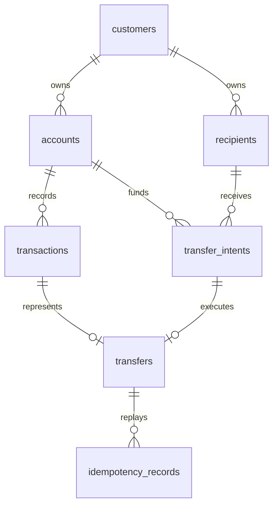

# PostgreSQL schema — M21

## M21 Public content schema additions

V6 adds ten Public-owned tables: 37 application/session tables total (Flyway history excluded). V1–V5 are unchanged. Customer repositories must not read Public tables; Public repositories must not read Customer tables.

| Table                     | Structure and constraints                                                                                                      |
| ------------------------- | ------------------------------------------------------------------------------------------------------------------------------ |
| public_catalog            | ID PK, unique slug/order, category/type/title/description/tags/currency, TIMESTAMPTZ provenance; flexible editorial body JSONB |
| public_catalog_fees       | Catalog FK + order composite PK; structured label/value/conditions                                                             |
| public_support            | ID PK, unique slug/order, category/title/summary/tags; structured section JSONB, explicit related IDs                          |
| public_rate_set           | Singleton reference PK, as-of/source/disclaimer, DEMO_RATE constraint                                                          |
| public_rates              | ID PK, set FK, nonnegative NUMERIC value, kind enum, unit/conditions and unique order                                          |
| public_offers             | ID PK, category/title/summary/route, TIMESTAMPTZ valid window CHECK, unique order                                              |
| public_navigation_groups  | ID PK, label/route/description, semantic section/link JSONB and unique order                                                   |
| public_categories         | Route PK, title/description/provenance and unique order; services derived at read time                                         |
| public_presentation       | Singleton home PK, hero/security notice JSONB, authored featured IDs; no financial or full Home snapshot                       |
| public_service_categories | ID PK, semantic card fields/provenance and unique order                                                                        |

All Public provenance has NOT NULL and DEMO constraints. Slug and display-order UNIQUE indexes protect stable lookup/order. Catalog category/type and support category indexes match equality filters. Substring scans do not benefit from a speculative B-tree text index, so no search index or external engine is added. Rate scale is preserved by unconstrained NUMERIC and BigDecimal. Times use TIMESTAMPTZ. No trigger or auto-DDL.

[Public Content domain](public-content-domain.md) documents seed ownership, authored search order and profile isolation.

## M19 Wealth schema additions

V5 adds six tables (27 application/session tables total, excluding flyway_schema_history):

| Table                    | Ownership and constraints                                                                                                                                                                          |
| ------------------------ | -------------------------------------------------------------------------------------------------------------------------------------------------------------------------------------------------- |
| investment_products      | Bank reference product PK; type/risk/currency/status enums; positive minimum, nonnegative fee/version; deterministic display order                                                                 |
| customer_risk_profiles   | Customer PK/FK; R1–R5, nonnegative version, expires_at > assessed_at                                                                                                                               |
| portfolio_positions      | Position PK, customer/product FKs; unique(customer,product) and unique(customer,position); CNY, nonnegative value/cost/contributions; business version and as-of                                   |
| suitability_checks       | Check PK, customer/product FKs; immutable risk/version/result/reasons evidence; expiry exactly 30 minutes; owned check/product composite unique                                                    |
| investment_order_intents | Intent PK; owned account and check/product FKs; positive principal, nonnegative fee, total = principal + fee, CNY; PREPARED/EXECUTED/EXPIRED; 64-hex hash, 15-minute expiry, versioned JSON review |
| investment_orders        | Order PK; UNIQUE intent and transaction; owned intent/account/transaction/position FKs; completion time, reference and versioned receipt                                                           |

idempotency_records gains investment_order_id and its composite owner FK. The operation/receipt CHECK permits exactly one of Transfer/Card/Recurring/Investment receipts for its matching operation. Existing keys remain scoped by customer + operation + key.

Minimal indexes follow reads: portfolio's unique customer/product index also covers owner reads; suitability owner/product; intent owner/product and owned unique ID; orders customer/completed_at. There is no expiry scan/job or status listing API requiring speculative extra indexes.

One shared database transaction coordinates AccountMutationPort (JPA), TransactionMutationPort (JPA), Wealth JDBC rows and idempotency. The customer lock is acquired first; product FOR SHARE and risk/account/position locks protect prerequisites and writes. Position version checks and UNIQUE order/intent are additional integrity guards. No triggers. See [Wealth domain](wealth-domain.md) and [ADR 0016](../adr/0016-wealth-suitability-and-investment-execution.md).

Flyway V1–V5 own twenty-seven tables: seven banking tables, seven security/session tables, three Card tables, four Recurring tables and six Wealth tables. Hibernate uses ddl-auto=validate; it never creates or updates this schema. Domain/application types have no JPA annotations or dependencies.

| Table               | Ownership and integrity                                                                                                                              |
| ------------------- | ---------------------------------------------------------------------------------------------------------------------------------------------------- |
| customers           | customer_id PK; display name, creation/as-of times, seed marker and transaction revision; no authentication/KYC data                                 |
| accounts            | account_id PK; customer FK; unique customer/account pair; non-negative balance/pending and pending <= balance                                        |
| transactions        | transaction_id PK; composite customer/account FK; separate merchant and counterparty columns; amount >= 0                                            |
| recipients          | recipient_id PK; customer FK; masked bank identifier only                                                                                            |
| transfer_intents    | intent_id PK; owned account/recipient FKs; immutable version-1 JSON snapshot plus typed amount, fee, total, currency, hash, lifecycle and timestamps |
| transfers           | transfer_id PK; unique intent_id and transaction_id; composite owner FKs; typed financial fields and version-1 receipt snapshot                      |
| idempotency_records | composite PK(customer_id, operation, idempotency_key); fingerprint, COMPLETED status, owned Transfer or CardAction FK and completion timestamps      |

All identifiers use explicit snake_case column mappings. Historical transactions.card_id remains an opaque nullable reference; it is not retroactively made a Card foreign key. The new cards table separately enforces its owned account relationship. Composite foreign keys prevent attaching another customer's account, recipient, intent, transaction or receipt.

## Money and time

Financial columns are NUMERIC(24,2): twenty-two whole digits and two fractional digits, comfortably above the frozen twelve-whole-digit Transfer limit. Current CNY/USD minor units use two decimals. Adding currencies with different minor units requires an explicit schema/domain migration; this is not a universal currency-scale assumption. FX rates use NUMERIC(24,10). Java uses BigDecimal and API output remains decimal string. No float/real/double financial column exists.

Business timestamps use TIMESTAMPTZ. Hibernate JDBC timezone and Compose server timezone are UTC. Original offsets may normalize to UTC while preserving the instant. New backend Intent/Transfer times are normalized to microseconds to match PostgreSQL precision and keep receipt replay and transaction timestamps identical. JSON review snapshots retain their confirmed timestamp strings.

## Query indexes and ordering

Transactions have three workload indexes:

- (customer_id, occurred_at DESC, transaction_id ASC)
- (customer_id, account_id, occurred_at DESC, transaction_id ASC)
- (customer_id, card_id, occurred_at DESC, transaction_id ASC), partial for non-null card IDs

transaction_id uses C collation so UTF-8 identifier order matches the application's code-point ordering. Filters, keyset continuation and limit+1 are performed in SQL. Search uses strpos over separately stored Locale.ROOT-lowercased title/merchant/counterparty values. This retains literal substring semantics and avoids locale-dependent PostgreSQL lower() differences; percent/underscore are ordinary characters, not LIKE wildcards. Reference is excluded.

## Locks, constraints and migrations

Banking write operations acquire the owned customer row using FOR NO KEY UPDATE first, then Intent/account/Card row locks as needed. This serializes customer mutations while allowing security-event foreign-key KEY SHARE checks; it avoids a customer/session lock cycle. Customer locking serializes writes per customer and ensures idempotency lookup occurs after an earlier concurrent commit. Source accounts additionally use FOR UPDATE. Different customers do not share a JVM or database-global mutation lock.

Transfer execution uses READ COMMITTED transactions. Composite reads use REPEATABLE READ, keeping selected transactions and cursor revision in one snapshot. Account debit increments no public version; transaction append advances a durable owner-scoped revision. Old cursors become invalid after a committed mutation.

Unique constraints independently defend one Transfer per Intent and one result per idempotency scope. Foreign keys, NOT NULL and numeric checks protect structural integrity. Java domain/application code owns financial orchestration; no triggers or stored procedures are used.

V1__initial_banking_schema.sql contains schema only. Local demo initialization is separate and transactional. After release, migrations are immutable; V2 added security/session state and V3 adds Cards plus the shared idempotency receipt extension. V1–V3 remain unchanged in M18; V4 adds Recurring state and its idempotency receipt extension. Schema creation never depends on manual SQL.

## Card and Security persistence

Security tables are customer_credentials, spring_session, spring_session_attributes, security_sessions, step_up_challenges, action_authorizations and security_events. See [authentication/session](authentication-session.md) and [Step-Up authorization](step-up-authorization.md).

V3__card_domain.sql adds:

| Table               | Integrity                                                                                                                                                                             |
| ------------------- | ------------------------------------------------------------------------------------------------------------------------------------------------------------------------------------- |
| cards               | PK; customer FK; owned account composite FK; masked number check; enum checks; required controls; non-negative business version and separate JPA row version                          |
| card_action_intents | PK; owned Card FK; unique customer/intent pair; hash, action, lifecycle and risk/authorization checks; before/after version; bounded expiry; immutable versioned JSON review snapshot |
| card_actions        | PK; unique intent; owned Card/Intent FKs; completed receipt, reference and versioned JSON snapshot                                                                                    |

Indexes serve customer-ordered Card listing and owned Card intent/receipt lookups. Existing idempotency_records retains its customer/operation/key primary key. V3 adds card_action_id and a check requiring exactly the appropriate receipt FK for EXECUTE_TRANSFER or EXECUTE_CARD_ACTION.

Card execution uses the same JpaTransactionManager as security JDBC persistence. Card row, receipt, intent lifecycle, authorization consumption, security event and idempotency receipt roll back together. No database trigger orchestrates the workflow. See [Card domain](card-domain.md) for lock ordering and replay precedence.

Local/test seed inserts missing Cards without resetting existing controls, status or versions. Default runtime does not seed Cards.

## Recurring persistence and derived Spending — M18

V4__recurring_payments.sql adds four tables:

| Table                               | Ownership and integrity                                                                                                                                                                          |
| ----------------------------------- | ------------------------------------------------------------------------------------------------------------------------------------------------------------------------------------------------ |
| recurring_payments                  | PK; owned account/card FKs; enum checks; non-negative NUMERIC usual amount and business version; STOPPED implies null next_expected_at; detected evidence metadata and non-manageable capability |
| recurring_payment_transaction_links | Composite owner/payment/account and owner/account/transaction FKs; PK(payment,transaction); unique payment/position; matched flag identifies provenance evidence                                 |
| recurring_payment_action_intents    | PK; owned payment FK; immutable versioned JSON review; hash/lifecycle/time columns; 15-minute expiry; unique owner/intent                                                                        |
| recurring_payment_actions           | PK; owned payment/intent FKs; unique intent; effective time/reference/versioned receipt; unique owner/action                                                                                     |

V4 adds a unique owner/account/transaction key on transactions for the historical link FK. Historical records are not duplicated or rewritten. Existing idempotency_records gains recurring_action_id and an owned receipt FK; its operation/receipt CHECK now accepts exactly one appropriate Transfer/Card/Recurring receipt. Existing scopes remain unchanged.

The recurring_owner_order index supports actual customer-scoped list order. Intent/action indexes support owner/payment reference lookup; PKs and unique indexes serve direct ID retrieval and concurrency. The frozen list has no status/type/date filters, and no scheduler exists, so customer/status and customer/next_expected_at indexes are intentionally deferred until a real query needs them.

No Spending table is added. Queries filter and aggregate authoritative transactions with SUM/COUNT/GROUP BY. Existing customer/date and customer/account/date indexes support bounded windows; no additional analytics index was added for the current 61-row fixture.

Recurring writes join the existing JpaTransactionManager using JDBC, lock customer then owned payment/intent rows, and update the business version conditionally. Mutation, Intent, receipt and idempotency commit atomically. No trigger coordinates business behavior.
