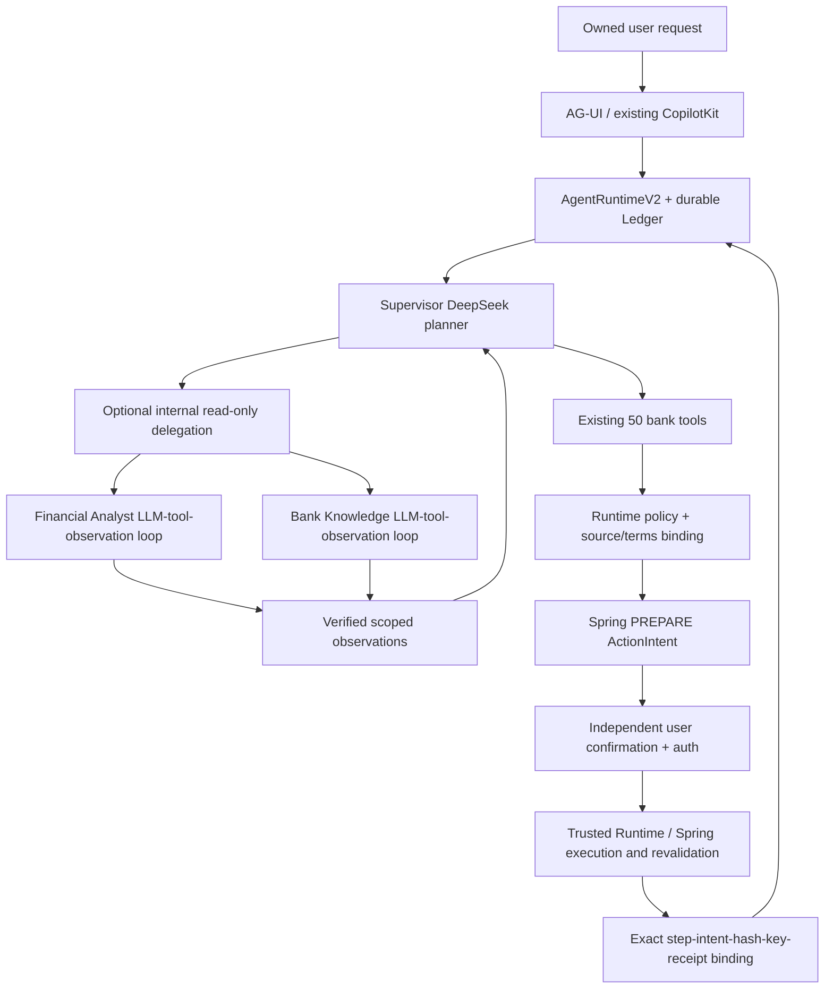

# Final Sprint — baseline and execution order

2026-10-20. Baseline `542a6bbd5ee3ba8849a461f044bba4e06878693e`, clean working tree before this sprint. Work is confined to `D:\BankProject-AGUI-20261012`; the original project and external architecture research are read-only inputs.

## Sprint 0 findings

- The research amount probe matches current code: whole-turn numeric cardinality rejects both legitimate amounts in a two-transfer request. Same-kind Ledger receipts are assigned by observation order. These are P0 source defects, not merely missing documentation.
- Existing Spring intent hash, session/ownership checks, action authorization and execution idempotency remain the sole financial execution boundary. No Customer API or historical migration change is planned.
- Runtime already has durable JSON task checkpoints, leases/CAS, pending intent lifecycle and transfer reconciliation. Its current same-kind semantic completion proof needs repair; non-transfer recovery must remain UNKNOWN/PARTIAL where no authoritative receipt is available.
- Six current project containers are healthy, including Knowledge. Existing MCP/Knowledge deployment was restored previously; verify current flags and retrieval rather than assuming the older zero-document report still applies. Running images are older than the baseline reasoning/progress source and need separate deployment verification.
- Initial resource check: 6906 MiB available physical memory but only 1183 MiB commit headroom. Builds, new Spring stacks and heavy browser suites are ENVIRONMENT_BLOCKED until the existing resource guard passes. No user process, paging policy or data volume will be altered to bypass that guard.

## Acceptance freeze

`benchmark-spec.json` preserves the external AB01–AB20 specification and its original SHA-256. `benchmark-results.json` starts every case at NOT_RUN; separate run evidence will distinguish unit, fake bank, real Spring/PostgreSQL, real model and browser. Local baseline artifacts reside under `artifacts/final-sprint/`, outside source distribution. Historical FAIL/PARTIAL records remain intact.

## Work sequence

1. Sprint 1: reproduce the two P0 defects; implement original-user-span validation and step→intent→terms hash→execution key→receipt binding. Preserve the amount veto; reject ambiguous or exchanged terms. Gate further financial work on deterministic tests.
2. Sprint 2: recheck current UX4.7, dates/coverage, navigation and six-domain behavior. Repair only reproducible gaps; preserve source/runtime distinctions.
3. Sprint 3: add optional serial, bounded read-only specialist loops under the existing Supervisor and Ledger. Feature flag defaults off. Specialists cannot prepare or execute actions; no recursive delegation or model-supplied identity.
4. Sprint 4: run security/recovery cases at the evidence level actually available. Database assertions and delivered attack payload evidence are required for corresponding live claims.
5. Sprint 5: only rebuild changed components when resource preflight passes; verify fingerprints, real model, browser and bank state. Report CODE_COMPLETE, TEST_VERIFIED, LIVE_E2E_VERIFIED, DEMO_READY and PRODUCTION_READY independently.

The 48-hour budget is a prioritization constraint, not permission to infer unexecuted tests passed. S1/R1 remain PARTIAL until their independent gates close.

## Implemented call paths and final boundary

`multi_agent.py` extends the source registry only when the flag is enabled (52 visible entries: 50 bank tools + 2 internal delegation capabilities). Off remains 50. Specialists are not financial executors. `financial_terms.py` owns provenance/binding; `completeness.py` validates Ledger completion; `agui_adapter.py` and existing `agent-progress.tsx`/`copilot-workspace.tsx` carry bounded role/status events. No bank contract or Flyway change was made.

New source native read-only model comparison and existing deployed MCP/Knowledge comparison passed separately. Latest image deployment is still resource-blocked. The complete independent gate decisions and unresolved acceptance scope are in `final-acceptance.md`; no architecture drawing implies deployed functionality.
