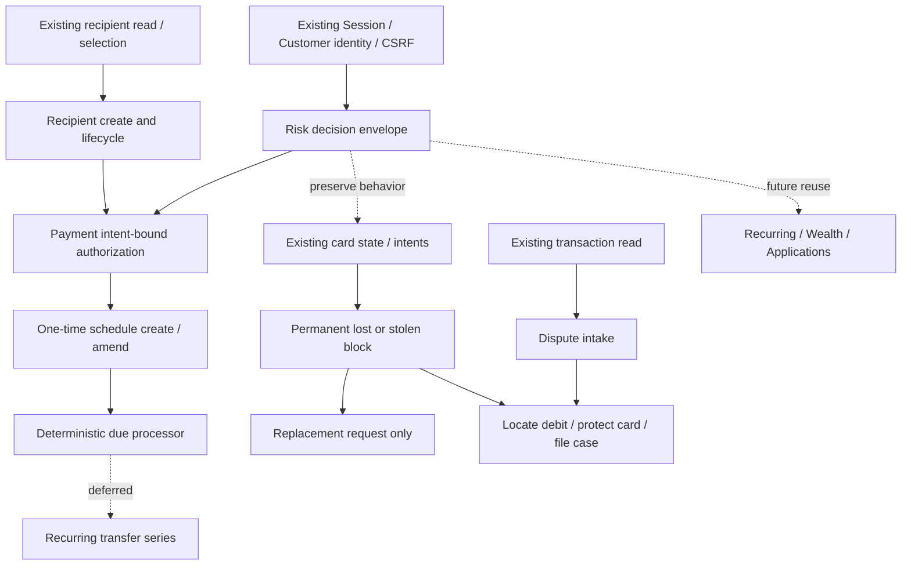

# B1 — Capability Dependencies & Architecture Reuse

日期：2026-09-30。所有箭头表示未来实施依赖；B1 不执行代码变更。

## 复用矩阵（实际源文件已核对）

| 现有资产 | 复用位置 | 不能直接复用的部分 |
|---|---|---|
| `security/application/SecurityService.java` | challenge、尝试次数、时钟、events | resourceType 当前只接受 CARD_ACTION_INTENT，付款须后续扩展 |
| `security/application/ActionAuthorizationService.java` | validate/consume port；同事务单次消费 | 不能给新资源套用旧 card grant |
| `security/domain/SecurityState.java` | customer/session/type/id/hash binding、状态 | 不给 Session 永久 AAL2 |
| SpringSecurityCurrentCustomerProvider + Spring Session | 所有 customer 读写 | 不接受 request customerId 或假 header |
| `customer/payment/application/TransferPreparationService.java` | 业务验证、费用、准备展示 | 未来 schedule 不能持有短效 transfer intent 到下个月 |
| `customer/payment/application/TransferExecutionService.java` | available balance 重查、原子出账/transaction/receipt | 当前未集成付款 grant；不可从 scheduler 假造 session |
| `customer/payment/domain/IntentHasher.java` | 版本前缀、规范金额、明确 canonical fields | 不修改已冻结 V1 hash 解释；新条款新版本 |
| IdempotencyRepository 与各 execution boundary | scoped key/fingerprint、回执重放、rollback | 不是所有新领域共用一张万能 intent 表 |
| `customer/card/domain/Card.java` + CardService | before/after/version、保护/提权、回执 | permanent block 不等于 FREEZE；numeric limits 尚无 enforcement |
| RecurringService + RecurringIntentHasher | stop 的资格、version、幂等模式 | bank-managed mandate 不等于 standing order |
| WealthService + InvestmentIntentHasher | suitability/profile/product version 与确认 | 授权风险不能替代投资适当性 |
| TransactionQueryService / AccountMutationPort | 历史定位、原子资金变化 | dispute intake 不触发财务更正 |

所有 Java 路径相对 `services/banking-core/src/main/java/com/asterbank/banking/`。无新的 Spring/JPA/HTTP 依赖进入 domain/application。

## Human–Agent parity

| 能力 | 分类 | 人工入口 |
|---|---|---|
| 收款人解析/创建/停用、付款授权 | MANUAL_EXACT | Payments 选择/管理/审阅 |
| 计划创建/修改/取消 | MANUAL_EXACT | Payments → schedule detail |
| 争议登记/取消 | MANUAL_EXACT | Transaction detail → Report a problem |
| 永久挂失/补卡受理 | MANUAL_EXACT | Card detail |
| 通用风险决策 | PRIMITIVES_ONLY | 嵌入以上审阅页，无独立客户“风险中心” |
| 预算→计划 / 交易→保护→争议 | PRIMITIVES_ONLY | 人能顺序完成底层动作；无需复刻聊天宏按钮 |
| process-due 测试/操作触发 | EVALUATION_ONLY | 不开放 customer/Agent 调用；只是执行基础设施 |
| 投资问卷、周期转账、数额限额 | 未来 MANUAL_EXACT | 本轮 DEFER，不把尚无 UI 的 API 算完成 |

EVALUATION_ONLY 不豁免客户能力的 UI：客户仍须能创建、查看、修改和取消已接受的计划；内部到期 runner 的权限与用户 session 分离。

## Application Center 最终规则

My Applications / Personal Center 用于状态、历史、回执与请求聚合。它可以链接银行卡/贷款申请、补卡请求或争议，但不把这些异构状态强塞进 ProductApplication 的 enum 或表。

创建从相关产品/资源原页开始，登录后回原页并恢复合理草稿，不能把普通申请/争议操作改成跳个人中心。已有内嵌产品申请保持不变。跨域聚合若未来开发，需要单独只读模型；不是本批前置条件。

## 共用变更协议

所有客户 mutation：AAL1 + CSRF，明确确认；prepare intent 由 server 生成 hash、展示可信条款；execute 带幂等键并重新查 owner/version/eligibility；按需消费精确绑定的 AAL2。读取为 ALLOW。保护性 stop/block/cancel 不被高额付款规则误加认证障碍。

组合不是一个全局跨域 transaction：挂失成功、争议失败时应保留保护并可重试争议，不能以失败为由解封。Agent 未来也不得省略确认或直接调用 DB/内部执行器。
